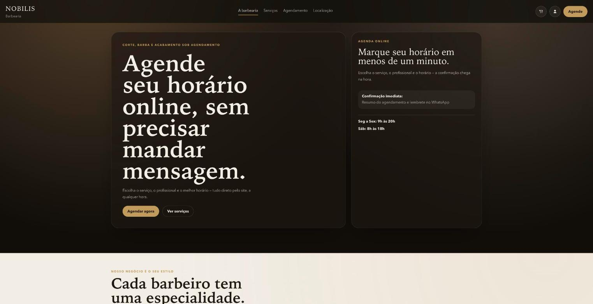
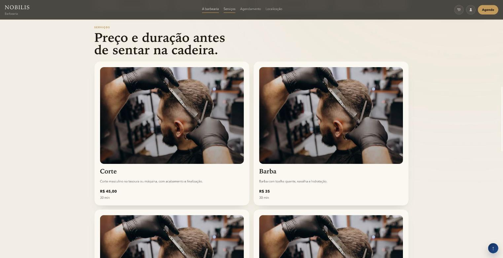
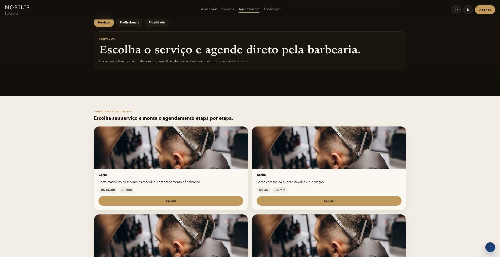
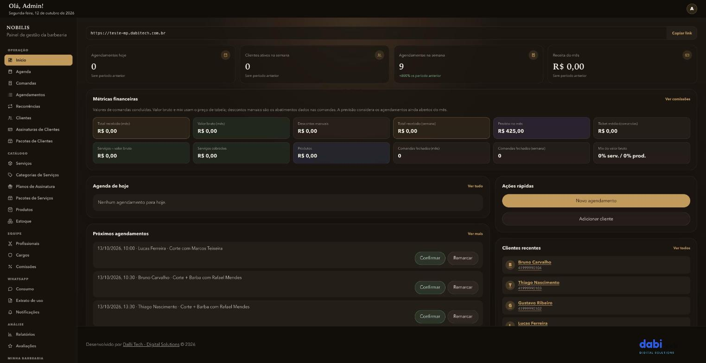
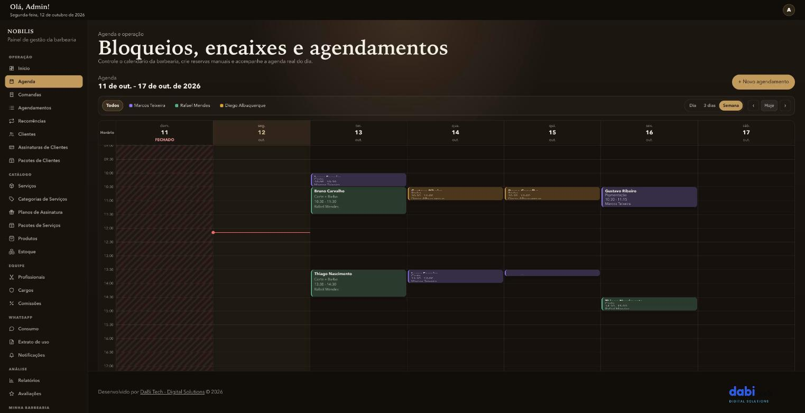
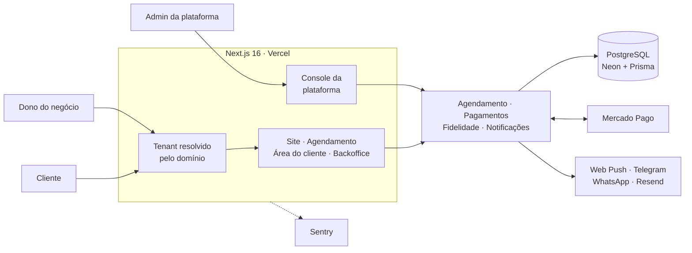

# DaBi Agendaí

**Plataforma SaaS multi-tenant de agendamento para negócios que atendem por horário marcado** (barbearias, salões, estúdios e clínicas).

Quem atende por horário costuma operar no WhatsApp e no caderno, e paga por isso com conflito de agenda, tempo perdido confirmando horário e cliente que não aparece. No Agendaí, cada estabelecimento ganha um subdomínio próprio com site, agendamento online, pagamento online, área do cliente, backoffice completo e assinatura da plataforma. O cliente agenda e paga sozinho, e o dono é avisado na hora.

> 🔒 **O código-fonte é privado** por ser um produto comercial da [DaBi Tech](https://dabitech.com.br). Este repositório documenta a arquitetura, as decisões técnicas e o meu papel no projeto. Posso liberar acesso de leitura ou apresentar o código em uma conversa técnica: [LinkedIn](https://www.linkedin.com/in/moysesemanuel/).

🔗 **Demo:** [barbearia-teste.dabitech.com.br](https://barbearia-teste.dabitech.com.br), barbearia fictícia de demonstração

---

## Em números

| | |
|---|---|
| **Escala do código** | ~75 modelos de dados e 9 rotinas agendadas |
| **Testes** | ~660 casos automatizados em 90 arquivos, mais E2E com banco real |
| **Histórico** | 570+ commits e 220+ pull requests, em produção desde o início |
| **Equipe** | 1 pessoa, do produto à operação |

---

## Meu papel

Desenvolvi o produto sozinho, de ponta a ponta:

- **Produto:** defini os módulos, os fluxos de agendamento e de pagamento, e o modelo de planos.
- **Arquitetura:** desenhei o modelo multi-tenant por domínio, com dados, sessões e permissões isolados por estabelecimento.
- **Back-end e front-end:** Next.js 16 com App Router, React 19, Prisma e PostgreSQL, do schema às telas.
- **Pagamentos:** cobrança da assinatura da plataforma e pagamento online do cliente final (Pix e cartão) pelo Mercado Pago, com conta conectada por OAuth em cada estabelecimento.
- **Integrações:** Web Push, Telegram, WhatsApp Cloud API e e-mail transacional.
- **Qualidade e operação:** testes unitários e E2E, CI no GitHub Actions, observabilidade com Sentry e deploy na Vercel.

---

## O que o produto cobre

Agendamento online com carrinho de vários serviços, pagamento online, área do cliente, comandas, estoque e comissões, pacotes de serviços, clube de assinatura do cliente, fila de espera, agendamento recorrente, avaliações, relatórios, cargos e permissões, domínio próprio e app instalável (PWA).

---

## Telas

| Site do estabelecimento | Serviços | Escolha do serviço |
|---|---|---|
|  |  |  |
| **Escolha do horário** | **Backoffice** | **Agenda** |
|  |  |  |

---

## Arquitetura

Detalhes em [docs/arquitetura.md](docs/arquitetura.md).

---

## Destaques de engenharia

**Zero agendamento duplicado.** Criar e remarcar um horário acontece dentro de uma transação com isolamento `Serializable`, que relê a agenda do profissional antes de gravar. Se dois clientes disputam o mesmo horário, o banco rejeita um deles e a pessoa recebe uma mensagem clara para escolher outro. Escolhi o driver da Neon em modo WebSocket porque o modo HTTP não suporta transações interativas. Veja [docs/decisoes-tecnicas.md](docs/decisoes-tecnicas.md).

**Isolamento entre tenants garantido por teste.** Todos os estabelecimentos dividem o mesmo banco, e o que os separa é a coluna do tenant. Um teste lê o código-fonte e o schema e falha se qualquer consulta a uma tabela com tenant não citar o tenant no `where`, inclusive em `update` e `delete` por id. Exceções precisam de justificativa explícita no código.

**Pagamentos que se corrigem sozinhos.** Webhooks do Mercado Pago são idempotentes por provedor e id de evento, e rotinas de reconciliação consultam o provedor para fechar o que o webhook perdeu. Os tokens OAuth de cada estabelecimento ficam criptografados no banco (AES-256-GCM). Pagamentos com problema geram tela para o dono, e-mail, aviso à equipe e evento no Sentry.

**Permissões que não regridem.** Cargos (Gerente, Recepção, Profissional) têm suas telas e rotas travadas por testes. Se uma mudança expõe a um cargo algo que ele não deveria ver, o CI falha.

**Fuso horário protegido por teste.** Um servidor em UTC desloca o "dia" perto da meia-noite. As datas de agenda são sempre calculadas no fuso de São Paulo, e um teste varre o código e falha se alguém usar `UTC` sem justificar na mesma linha.

**E2E com banco real no CI.** Toda PR roda lint, typecheck e testes unitários, depois sobe um Postgres, cria um estabelecimento de teste com credenciais geradas na hora e roda os testes E2E com Playwright. Veja [docs/testes-e-ci.md](docs/testes-e-ci.md).

**SEO e GEO.** Cada estabelecimento tem sitemap, robots, imagem Open Graph dinâmica e um `llms.txt` próprio, para ser bem lido por buscadores e por assistentes de IA.

---

## Stack

`Next.js 16` `React 19` `TypeScript` `Prisma` `PostgreSQL (Neon)` `Zod` `Mercado Pago` `Web Push` `Telegram` `WhatsApp Cloud API` `Resend` `Sentry` `Vitest` `Playwright` `GitHub Actions` `Vercel`

---

## Autor

**Moyses Emanuel**, Desenvolvedor Full Stack · Curitiba, PR
[LinkedIn](https://www.linkedin.com/in/moysesemanuel/) · [GitHub](https://github.com/moysesemanuel) · [mecs.cwb@gmail.com](mailto:mecs.cwb@gmail.com)
